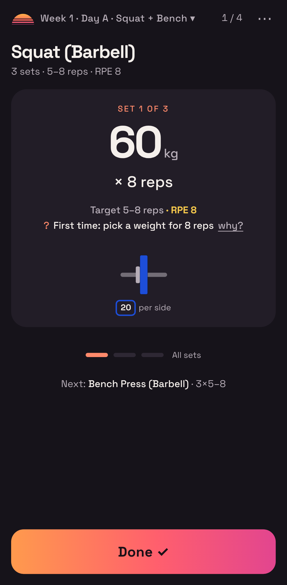
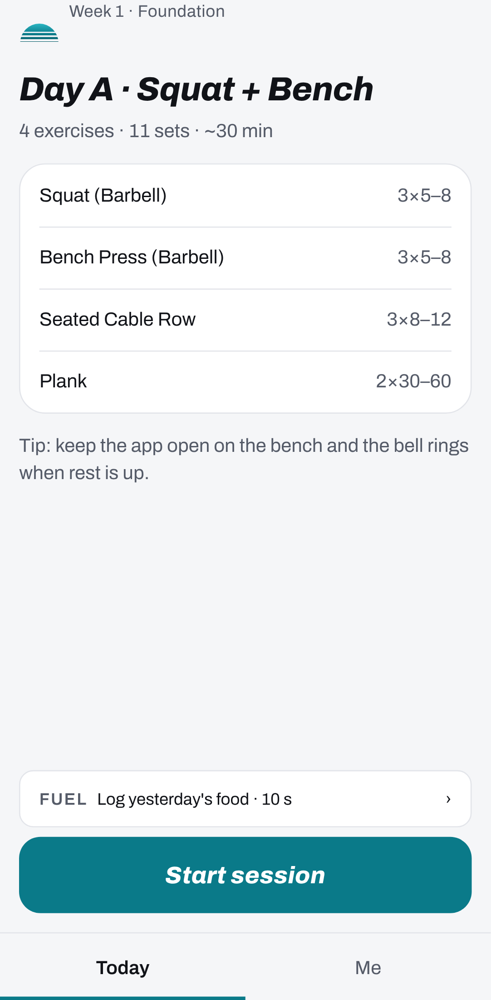

# Retro Tracker

An offline-first workout tracker for the gym. You open it, tap DONE after each set, and it works out what to lift next time, including when to back off with a deload.

I built it to replace a set of PHP trackers I'd written for myself and a few people I train with. Those worked, but they had no proper accounts and were awkward to use mid-set. This version runs entirely on the phone and syncs when it can.

<p>
  
  
</p>

## What it does

- **One tap per set.** A big card shows the weight and reps for the current set. Tap a number to change it, then tap DONE. Warm-ups come first, and the rest timer starts automatically.
- **Progression built in.** It suggests the next weight from your recent sessions, rounds it to what your gym can actually load, and schedules deloads. A "why?" link explains every suggestion.
- **Plate maths.** Tell it which plates and bar your gym has and it draws what goes on each side.
- **Works offline.** Everything is stored on the phone (IndexedDB). Every change is queued and synced later, so a dead spot in the gym never loses a set.
- **Cloud sync.** Optional, through Supabase, with sign-in by a 6-digit email code. A workout only stays live on the phone that started it, so two devices can't disagree about where you are in the programme.
- **Bring your history.** Imports a Strong CSV export or my old PHP tracker logs, with a preview first and nothing written until you confirm.
- **Your data, your call.** Export everything as JSON or CSV, restore from a backup, or delete everything (on the phone and in the cloud) behind a typed confirmation.
- **Two themes.** A dark "Sunset Chrome" theme and a light "Daylight" theme, following the phone's setting.
- **Accessible.** Large touch targets, strong contrast, screen-reader labels on every control and keyboard shortcuts on desktop. Accessibility is tested automatically. See [DESIGN.md](DESIGN.md).

It's a PWA, so it installs to the home screen like a normal app.

## Built with

React 19, TypeScript, Vite and vite-plugin-pwa. Dexie (IndexedDB) on the device. Supabase for Postgres, auth and an Edge Function, with row-level security on every table. Vitest for unit tests, and Playwright with axe for end-to-end and accessibility tests.

## How it's put together

| Folder | What's in it |
| --- | --- |
| `src/engine` | The training logic as pure TypeScript: progression rules, rounding by equipment, plate maths, estimated 1RM and the deload schedule. No UI, so it's easy to test. |
| `src/db` | The local database, one per account, plus the outbox that queues every change for sync. |
| `src/sync` | Two-way sync with Supabase. Changes upload in dependency order and a new device does a full restore. If the server rejects a row, it's set aside without blocking the rest. |
| `src/features` | The screens: onboarding, today, the live session, session complete and settings. |
| `src/import` | Parsers for Strong exports and the old tracker's logs. |
| `supabase` | The schema, row-level security policies, a scheduled clean-up job and the delete-my-account function. |
| `scripts/migrate-php` | Converts programmes from my old PHP trackers into the new format. |
| `e2e` | Playwright flows at phone and desktop sizes, in both themes. |

## Run it

```bash
npm install
npm run dev        # http://localhost:5173 (add -- --host to try it on your phone)
npm test           # unit and sync tests
npm run e2e        # end-to-end and accessibility tests
npm run typecheck
npm run build      # production PWA in dist/
```

It runs fully locally without any setup. Cloud sync stays off until you add Supabase details.

### Turning on cloud sync

1. Create a Supabase project (I use an EU region).
2. In the SQL editor, run the files in `supabase/migrations` in order. Enable the `pg_cron` extension before running `0002`.
3. Under Auth, turn on Email OTP and set the email template to show `{{ .Token }}`. Add an SMTP provider, as Supabase's built-in mailer only sends a few emails an hour.
4. Deploy the Edge Function: `supabase functions deploy delete-my-account`.
5. Copy `.env.example` to `.env.local` and add the project URL and **anon** key. Never put the service-role key in the app.

`supabase test db` runs the row-level security tests in `supabase/tests`.

## Status

The phone side is complete and in use. Sync is built and covered by tests against a fake server, but hasn't yet been run against a live Supabase project.

Next up:
- the personal trainer's side (the database already supports sharing by code)
- progress graphs
- more set types such as drop sets
- a native iOS and Android wrapper using Capacitor
